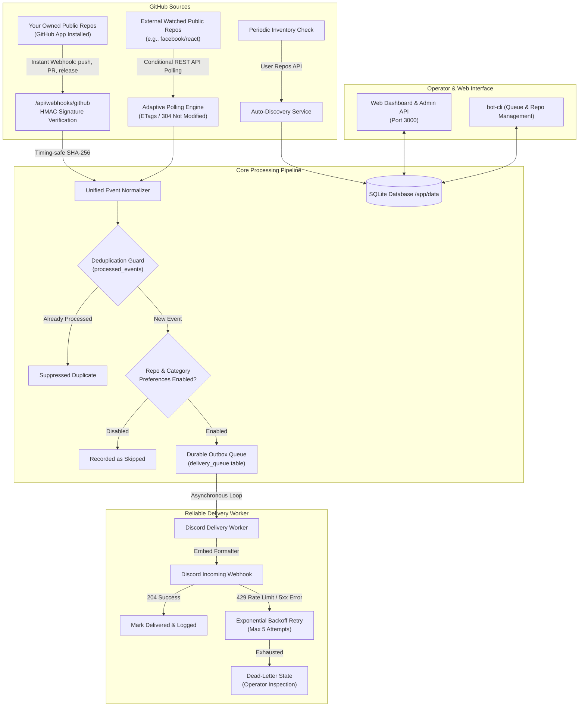

# GitHub Discord Bot

> Real-time GitHub repository activity monitoring and Discord notification dispatcher with durable outbox delivery and adaptive public API polling.

[](https://github.com/RajnishOne/github-discord-bot/actions/workflows/docker-publish.yml)
[](https://github.com/RajnishOne/github-discord-bot/pkgs/container/github-discord-bot)
[](LICENSE)

---

## 1. Project Overview

**GitHub Discord Bot** is a lightweight, self-hosted service designed to run on a home server, VPS, or NAS (such as OpenMediaVault). It bridges your public GitHub repositories and your Discord server by capturing activity in real time and sending beautifully formatted, actionable notification embeds to a designated Discord channel.

GitHub Discord Bot solves two core problems:
1. **Zero Configuration for Owned Repositories:** Once installed as a GitHub App on your GitHub account, GitHub Discord Bot automatically listens to all public repositories you own—including newly created ones—without requiring manual webhook setup on each repository.
2. **Universal Public Repository Watchlist:** For external open-source projects or repositories you don't own (e.g., `facebook/react`, `expressjs/express`, `torvalds/linux`), GitHub Discord Bot provides an adaptive polling engine that tracks releases, pull requests, issues, and commits using GitHub's public API while strictly respecting rate limits and ETag caching.

---

## 2. Architecture Diagram



---

## 3. Features & Supported GitHub Events

### Key Features
- **Dual Pipeline Monitoring:** Instant push webhooks for owned repositories + intelligent polling adapter for externally watched repositories.
- **Strict Private Repository Guard:** Enforced at validation and database constraint levels (`CHECK (is_private = 0)`). Private repositories are strictly rejected and never monitored.
- **Durable SQLite Outbox:** Events are durably persisted in SQLite before HTTP acknowledgement. If the container restarts or Discord experiences downtime, zero notifications are lost.
- **Zero-Duplicate Guarantee:** Deterministic deduplication keys guarantee that events received via both webhook and polling or re-sent by GitHub are only delivered once.
- **Discord Spam Protection:** All embeds enforce `allowed_mentions: { parse: [] }`, preventing user-generated content from triggering `@everyone`, `@here`, or unwanted role mentions.
- **Production-Ready Multi-Arch Docker Image:** Runs as a non-root user (`node`), supports `linux/amd64` and `linux/arm64`, includes container health checks, and mounts persistent SQLite storage.

### Supported Event Categories
| Category | Event Actions Monitored | Discord Embed Color |
| :--- | :--- | :--- |
| **🚀 Releases** | Published, Prerelease published, new tag version | Emerald Green (`#10B981`) |
| **🔀 Pull Requests** | Opened, Reopened, Closed, Merged, Ready for Review, Review Requested | Purple (`#8B5CF6`) |
| **🐛 Issues** | Opened, Reopened, Closed, Assigned, Labeled (excludes PRs) | Amber (`#F59E0B`) |
| **💻 Pushes** | Commits pushed to main/target branches with short SHA & commit count | Blue (`#3B82F6`) |
| **⭐ Stars & Forks** | Repository starred, unstarred (optional), repository forked | Pink / Indigo |
| **💬 Comments** | New comments on issues or pull requests (excludes edits) | Cyan (`#06B6D4`) |
| **👀 Code Reviews** | Submitted reviews (Approved ✅, Changes Requested ⚠️, Commented) | Teal (`#14B8A6`) |

---

## 4. Quickstart with Pre-Built Docker Image (GHCR)

The multi-architecture Docker image is automatically published to GitHub Container Registry (**GHCR**) for `linux/amd64` (Intel/AMD) and `linux/arm64` (Apple Silicon, Raspberry Pi, ARM servers):

```text
ghcr.io/rajnishone/github-discord-bot:latest
```

### Option A: Using Docker Compose (Recommended)

You don't need to clone the full repository code—simply create a folder on your server with a `docker-compose.yml` and `.env` file:

```bash
mkdir -p /docker-data/github-discord-bot/data
chown -R 1000:100 /docker-data/github-discord-bot/data
```

Create `docker-compose.yml`:
```yaml
services:
  github-discord-bot:
    image: ghcr.io/rajnishone/github-discord-bot:latest
    container_name: github-discord-bot
    restart: unless-stopped

    environment:
      - PUID=1000
      - PGID=100
      - TZ=Asia/Kolkata
      - NODE_ENV=production
      - PORT=3000
      - DATA_DIR=/app/data
      - GITHUB_OWNER=${GITHUB_OWNER:-RajnishOne}
      - GITHUB_WEBHOOK_SECRET=${GITHUB_WEBHOOK_SECRET}
      - GITHUB_TOKEN=${GITHUB_TOKEN}
      - DISCORD_WEBHOOK_URL=${DISCORD_WEBHOOK_URL}
      - ADMIN_API_KEY=${ADMIN_API_KEY}
      - DEFAULT_POLLING_INTERVAL=${DEFAULT_POLLING_INTERVAL:-300}

    volumes:
      - /docker-data/github-discord-bot/data:/app/data

    ports:
      - 3000:3000

    networks:
      - proxy

networks:
  proxy:
    external: true
```

Create `.env`:
```env
GITHUB_OWNER=RajnishOne
DISCORD_WEBHOOK_URL=https://discord.com/api/webhooks/your/webhook/url
GITHUB_TOKEN=ghp_yourPersonalAccessTokenHere # Optional but boosts API limits to 5,000/hr
GITHUB_WEBHOOK_SECRET=your_webhook_secret_here
DEFAULT_POLLING_INTERVAL=300
TZ=Asia/Kolkata
```

Start the bot:
```bash
docker compose up -d
docker compose logs -f
```

### Option B: Standalone `docker run`

```bash
docker run -d \
  --name github-discord-bot \
  --restart unless-stopped \
  -p 3000:3000 \
  -v $(pwd)/data:/app/data \
  -e DISCORD_WEBHOOK_URL="https://discord.com/api/webhooks/..." \
  -e GITHUB_TOKEN="ghp_..." \
  -e GITHUB_OWNER="your-username" \
  ghcr.io/rajnishone/github-discord-bot:latest
```

> [!TIP]
> **Ensuring GHCR Public Image Access:**
> To pull the image anonymously on any machine without `docker login`:
> 1. In GitHub, go to your repository or user profile → **Packages**.
> 2. Click **github-discord-bot**.
> 3. In the right sidebar, click **Package settings**.
> 4. Scroll to **Danger Zone** → **Change package visibility** → Select **Public** and confirm.

---

## 5. Using the Web UI to Configure & Add Public Repositories

GitHub Discord Bot includes a modern, responsive web dashboard available on port `3000` (`http://localhost:3000` or `http://<your-server-ip>:3000`).

### Initial Settings Setup
1. Open the dashboard in your browser.
2. In the top navigation bar, click **⚙️ Settings**.
3. Fill in your configuration:
   - **Discord Webhook URL:** Paste your channel's incoming webhook URL and click **Test Webhook** to send an instant operational test alert to your Discord channel.
   - **GitHub Personal Access Token (Optional):** Enter a PAT (Personal Access Token) with `public_repo` or read scope. This expands your GitHub API rate limit from 60 to **5,000 requests/hour** and enables auto-discovery of your owned public repos.
   - **GitHub App Webhook Secret (Optional):** Enter your webhook secret to cryptographically verify inbound webhooks.
4. Click **Save Settings**.

---

### Adding Watched Public Repositories (External Open-Source Projects)

Use this to track repositories you do not own (e.g. `expressjs/express`, `facebook/react`, `torvalds/linux`):

1. Click on the **👁️ Watched Repositories** tab.
2. Click **+ Add Repository** (or **+ Add Public Repository**).
3. In the modal:
   - **GitHub Repository:** Enter the repository identifier in either `owner/repository` format (e.g. `facebook/react`) or as a full GitHub URL (e.g. `https://github.com/expressjs/express`).
   - Click **Verify**: The bot performs an instant API check against GitHub to verify the repo exists, confirms it is strictly public, and displays its current stars, forks, and open issues count.
   - **Repository Ownership:** Leave **🔄 Watched Public Repository** selected.
   - **Notification Categories:** Check or uncheck the types of events you want forwarded to Discord:
     - 🚀 Releases *(recommended)*
     - 🔀 Pull Requests
     - 🐛 Issues
     - 💻 Commits & Pushes
     - ⭐ Stars
     - 🍴 Forks
   - **Polling Frequency:** Select how often the bot checks GitHub for new events:
     - Every 1 minute *(Fast-paced)*
     - Every 3 minutes
     - Every 5 minutes *(Recommended)*
     - Every 10 minutes
     - Every 30 minutes
4. Click **Start Monitoring**.
   The repository card will appear on the dashboard with its live polling timer, health indicator, and latest event summary.

---

### Adding & Auto-Discovering Owned Public Repositories

Use this for your own GitHub repositories where you want instant sub-second webhook notifications:

#### Method 1: One-Click Auto-Discovery
1. Switch to the **👑 My Repositories** tab.
2. Click the **✨ Auto-Discover Now** button in the banner.
3. The bot connects to your GitHub account (using the configured `GITHUB_TOKEN`), finds all public repositories you own, filters out any private ones, and registers them automatically.

#### Method 2: Manual Registration
1. Click **+ Add Repository**.
2. Enter your repository name (e.g. `your-username/your-repo`).
3. Click **Verify**.
4. Select **⚡ My Owned Repository**.
5. Select your category preferences and click **Start Monitoring**.

---

### Viewing Live Event Activity & Diagnostics
- **Activity Feed Tab:** Click **📡 Activity Feed** to view a live, chronological stream of all captured GitHub events, deduplication statuses, and Discord delivery results.
- **Rate Limit Indicator:** The pill in the top header monitors your remaining GitHub API quota in real-time.
- **Discord Status Indicator:** Displays whether Discord incoming webhook delivery is healthy, in mock mode, or experiencing backoff.

---

## 6. GitHub App Creation (For Real-Time Webhooks)

To receive real-time webhooks without adding webhooks manually repository by repository:

1. Go to **GitHub Settings** → **Developer settings** → **GitHub Apps** → **New GitHub App**.
2. Fill in the general settings:
   - **GitHub App name:** `GitHub-Discord-Bot-YourName` (must be globally unique).
   - **Homepage URL:** `https://github.com/your-username` (or your domain).
3. Webhook settings:
   - Check **Active**.
   - **Webhook URL:** `https://bot.yourdomain.com/api/webhooks/github` (your public HTTPS URL).
   - **Webhook secret:** Generate a strong secret (e.g. `openssl rand -hex 24`) and save it for `.env`.
4. Permissions (Repository permissions):
   - **Issues:** Read-only (subscribe to Issues, Issue comment).
   - **Pull requests:** Read-only (subscribe to Pull request, Pull request review, Pull request review comment).
   - **Contents:** Read-only (subscribe to Push, Release).
   - **Metadata:** Read-only (Mandatory, default).
5. Subscribe to events:
   - Check: `Push`, `Release`, `Issues`, `Issue comment`, `Pull request`, `Pull request review`, `Pull request review comment`, `Watch`, `Fork`.
6. Where can this GitHub App be installed?
   - Select **Only on this account**.
7. Click **Create GitHub App**.
8. Go to **Install App** in the left sidebar of your app, click **Install** next to your account, and select **All repositories**.

---

## 7. Discord Incoming Webhook Setup

1. In Discord, navigate to the text channel where you want notifications.
2. Click the gear icon (**Edit Channel**) → **Integrations** → **Webhooks** → **New Webhook**.
3. Name it `GitHub Discord Bot` and optionally set an icon.
4. Click **Copy Webhook URL**. Save this URL for your `.env` file (`DISCORD_WEBHOOK_URL`).

---

## 8. Environment Configuration Reference

| Variable | Description | Default / Example |
| :--- | :--- | :--- |
| `PORT` | Local container port | `3000` |
| `DATA_PATH` | Persistent host directory for SQLite | `./data` (or `/srv/dev-disk-by-uuid-.../data`) |
| `GITHUB_OWNER` | Your GitHub username | `octocat` |
| `GITHUB_WEBHOOK_SECRET`| The secret set in GitHub App settings | `your_secret_here` |
| `GITHUB_TOKEN` | Personal Access Token (for 5,000 req/hr & discovery) | `ghp_...` |
| `DISCORD_WEBHOOK_URL` | Discord Incoming Webhook URL | `https://discord.com/api/webhooks/...` |
| `ADMIN_API_KEY` | Optional security key for admin API/CLI | `secure_token` |
| `DEFAULT_POLLING_INTERVAL`| Default poll interval in seconds for external repos | `300` |

---

## 9. Nginx Proxy Manager / HTTPS Setup

GitHub requires a valid public HTTPS endpoint to deliver webhooks.

In **Nginx Proxy Manager (NPM)**:
1. Click **Add Proxy Host**.
2. **Domain Names:** `bot.yourdomain.com`
3. **Forward Hostname / IP:** `github-discord-bot` (if sharing a Docker network) or your server's local IP (e.g. `192.168.1.100`).
4. **Forward Port:** `3000`
5. Enable **Block Common Exploits** and **Websockets Support**.
6. On the **SSL** tab: Select your Let's Encrypt certificate, check **Force SSL** and **HTTP/2 Support**.
7. Click **Save**.

Your GitHub App webhook URL will be:
`https://bot.yourdomain.com/api/webhooks/github`

---

## 10. Administrative Controls & CLI

GitHub Discord Bot includes a built-in CLI for inspecting queue state, managing deliveries, and viewing monitored repositories:

```bash
# View outbox delivery queue status
docker compose exec github-discord-bot node bin/bot-cli.js queue:status

# List pending or failing delivery items
docker compose exec github-discord-bot node bin/bot-cli.js queue:pending

# Re-enqueue a failed delivery item
docker compose exec github-discord-bot node bin/bot-cli.js queue:retry <id>

# Re-enqueue all dead-letter items after fixing Discord webhook URL
docker compose exec github-discord-bot node bin/bot-cli.js queue:retry-all

# List all monitored repositories and health status
docker compose exec github-discord-bot node bin/bot-cli.js repos:list
```

Locally via npm:
```bash
npm run cli -- queue:status
npm run cli -- repos:list
```

---

## 11. Database Backup & Restore

GitHub Discord Bot stores all data in a single SQLite database inside `DATA_PATH` (default: `./data/github_discord_bot.sqlite`).

### Backup
```bash
# Safe hot backup using SQLite online backup
sqlite3 ./data/github_discord_bot.sqlite ".backup './data/backup_$(date +%Y%m%d_%H%M%S).sqlite'"
```

### Restore
```bash
# 1. Stop container
docker compose down

# 2. Restore file
cp ./data/backup_20261016.sqlite ./data/github_discord_bot.sqlite

# 3. Restart container
docker compose up -d
```

---

## 12. GitHub Actions CI/CD (Multi-Arch GHCR Workflow)

Whenever changes are pushed to `main` or a release tag (`v*.*.*`) is created, GitHub Actions automatically:
1. Runs the test suite on Node.js 22 (`npm test`).
2. Builds multi-architecture images for `linux/amd64` and `linux/arm64`.
3. Pushes the image to **GitHub Container Registry (`ghcr.io`)** tagged with:
   - `latest`
   - Short Git commit SHA (e.g. `sha-a1b2c3d`)
   - Semantic version tags (e.g. `v1.0.0`, `1.0`, `1`)

---

## 13. Troubleshooting & FAQ

### 1. Webhook Signature Mismatch (`401 Invalid webhook signature`)
- Verify that `GITHUB_WEBHOOK_SECRET` in `.env` matches the secret in your GitHub App settings exactly.
- Verify your reverse proxy does not modify the raw request body payload.

### 2. GitHub Rate Limits on External Repositories
- By default, unauthenticated GitHub API requests are limited to 60/hr.
- Configure `GITHUB_TOKEN` in `.env` or through the Web UI Settings to immediately expand your quota to **5,000 requests/hr**.
- GitHub Discord Bot uses conditional `ETag` requests (`304 Not Modified`), conserving rate limit quota.

### 3. Events Delivered Multiple Times
- GitHub Discord Bot tracks deterministic deduplication keys in `processed_events`. If duplicate webhooks or simultaneous polling events arrive, the second event is suppressed automatically.

---

## 14. License

MIT License © 2026 GitHub Discord Bot Contributors.
