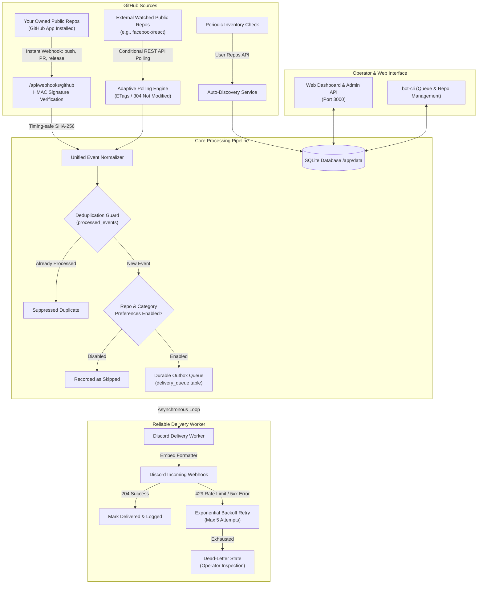

# GitHub Discord Bot

> Real-time GitHub repository activity monitoring and Discord notification dispatcher with durable outbox delivery and adaptive public API polling.

---

## 1. Project Overview

**GitHub Discord Bot** is a lightweight, self-hosted service designed to run on a home server or NAS (such as OpenMediaVault). It bridges your public GitHub repositories and your Discord server by capturing activity in real time and sending beautifully formatted, actionable notification embeds to a designated Discord channel.

GitHub Discord Bot solves two core problems:
1. **Zero Configuration for Owned Repositories:** Once installed as a GitHub App on your GitHub account, GitHub Discord Bot automatically listens to all public repositories you own—including newly created ones—without requiring manual webhook setup on each repository.
2. **Universal Public Repository Watchlist:** For external open-source projects or repositories you don't own (e.g., `facebook/react`, `expressjs/express`), GitHub Discord Bot provides an adaptive polling engine that tracks releases, pull requests, issues, and commits using GitHub's public API while strictly respecting rate limits and ETag caching.

---

## 2. Architecture Diagram



---

## 3. Features and Supported GitHub Events

### Key Features
- **Dual Pipeline Monitoring:** Instant push webhooks for owned repositories + intelligent polling adapter for externally watched repositories.
- **Strict Private Repository Guard:** Enforced at validation and database constraint levels (`CHECK (is_private = 0)`). Private repositories are never monitored or leaked.
- **Durable SQLite Outbox:** Events are durably persisted in SQLite before HTTP acknowledgement. If the container restarts or Discord experiences downtime, zero notifications are lost.
- **Zero-Duplicate Guarantee:** Deterministic deduplication keys guarantee that events received via both webhook and polling or re-sent by GitHub are only delivered once.
- **Discord Spam Protection:** All embeds enforce `allowed_mentions: { parse: [] }`, preventing user-generated content from triggering `@everyone`, `@here`, or unwanted role mentions.
- **Production-Ready Docker & OMV Deployment:** Runs as a non-root user (`node`), includes container health checks, and mounts persistent SQLite storage.

### Supported Event Categories
| Category | Event Actions Monitored | Discord Embed Color |
| :--- | :--- | :--- |
| **🚀 Releases** | Published, Prerelease published, new tag version | Emerald Green (`#10B981`) |
| **🔀 Pull Requests** | Opened, Reopened, Closed, Merged, Ready for Review, Review Requested | Purple (`#8B5CF6`) |
| **🐛 Issues** | Opened, Reopened, Closed, Assigned, Labeled (excludes PRs) | Amber (`#F59E0B`) |
| **💻 Pushes** | Commits pushed to main/target branches with short SHA & commit count | Blue (`#3B82F6`) |
| **⭐ Stars & Forks** | Repository starred, unstarred (optional), repository forked | Pink / Indigo |
| **💬 Comments** | New comments on issues or pull requests (excludes edits) | Cyan (`#06B6D4`) |
| **👀 Code Reviews** | Submitted reviews (Approved ✅, Changes Requested ⚠️, Commented) | Teal (`#14B8A6`) |

---

## 4. Prerequisites

- A Linux host or NAS (OpenMediaVault, Debian, Ubuntu, etc.) with **Docker** and **Docker Compose** installed.
- A GitHub account with permission to create a GitHub App.
- A Discord server where you have permission to manage webhooks.
- A public HTTPS endpoint (such as via Nginx Proxy Manager, Cloudflare Tunnel, or Caddy) so GitHub can deliver webhooks to your server.

---

## 5. GitHub App Creation & Installation Instructions

To receive real-time webhooks without adding webhooks repository by repository, create a GitHub App:

1. Go to **GitHub Settings** → **Developer settings** → **GitHub Apps** → **New GitHub App**.
2. Fill in the general settings:
   - **GitHub App name:** `GitHub-Discord-Bot-YourName` (must be globally unique).
   - **Homepage URL:** `https://github.com/your-username` (or your domain).
3. Webhook settings:
   - Check **Active**.
   - **Webhook URL:** `https://bot.yourdomain.com/api/webhooks/github` (your public HTTPS URL).
   - **Webhook secret:** Generate a strong secret (e.g. `openssl rand -hex 24`) and save it for `.env`.
4. Permissions (Repository permissions):
   - **Issues:** Read-only (subscribe to Issues, Issue comment).
   - **Pull requests:** Read-only (subscribe to Pull request, Pull request review, Pull request review comment).
   - **Contents:** Read-only (subscribe to Push, Release).
   - **Metadata:** Read-only (Mandatory, default).
5. Subscribe to events:
   - Check: `Push`, `Release`, `Issues`, `Issue comment`, `Pull request`, `Pull request review`, `Pull request review comment`, `Watch`, `Fork`.
6. Where can this GitHub App be installed?
   - Select **Only on this account**.
7. Click **Create GitHub App**.
8. Go to **Install App** in the left sidebar of your app, click **Install** next to your account, and select **All repositories**.

---

## 6. Discord Incoming Webhook Setup

1. In Discord, navigate to the text channel where you want notifications.
2. Click the gear icon (**Edit Channel**) → **Integrations** → **Webhooks** → **New Webhook**.
3. Name it `GitHub Discord Bot` and optionally set an icon.
4. Click **Copy Webhook URL**. Save this URL for your `.env` file (`DISCORD_WEBHOOK_URL`).

---

## 7. Environment Configuration

Copy `.env.example` to `.env` and fill in your values:

```bash
cp .env.example .env
```

| Variable | Description | Default / Example |
| :--- | :--- | :--- |
| `PORT` | Local container port | `3000` |
| `DATA_PATH` | Persistent host directory for SQLite | `./data` (or `/srv/dev-disk-by-uuid-.../data`) |
| `GITHUB_OWNER` | Your GitHub username | `octocat` |
| `GITHUB_WEBHOOK_SECRET`| The secret set in GitHub App settings | `your_secret_here` |
| `GITHUB_TOKEN` | Personal Access Token (for 5,000 req/hr & discovery) | `ghp_...` |
| `DISCORD_WEBHOOK_URL` | Discord Incoming Webhook URL | `https://discord.com/api/webhooks/...` |
| `ADMIN_API_KEY` | Optional security key for admin API/CLI | `secure_token` |
| `DEFAULT_POLLING_INTERVAL`| Default poll interval in seconds for external repos | `300` |

---

## 8. Docker Compose Deployment (OpenMediaVault)

On OpenMediaVault (or any Docker host):

```bash
# 1. Clone repository
git clone https://github.com/your-username/github-discord-bot.git /opt/github-discord-bot
cd /opt/github-discord-bot

# 2. Configure environment
cp .env.example .env
nano .env

# 3. Create persistent data directory
mkdir -p ./data
chown -R 1000:1000 ./data

# 4. Build and start service
docker compose up -d --build

# 5. Check logs
docker compose logs -f
```

---

## 9. Nginx Proxy Manager / HTTPS Setup

GitHub requires a valid public HTTPS endpoint to deliver webhooks.

In **Nginx Proxy Manager (NPM)**:
1. Click **Add Proxy Host**.
2. **Domain Names:** `bot.yourdomain.com`
3. **Forward Hostname / IP:** `github-discord-bot` (if sharing a Docker network) or your server's local IP (e.g. `192.168.1.100`).
4. **Forward Port:** `3000`
5. Enable **Block Common Exploits** and **Websockets Support**.
6. On the **SSL** tab: Select your Let's Encrypt certificate, check **Force SSL** and **HTTP/2 Support**.
7. Click **Save**.

Your GitHub App webhook URL will be:
`https://bot.yourdomain.com/api/webhooks/github`

---

## 10. Administrative Controls & CLI

GitHub Discord Bot includes a built-in CLI for inspecting queue state, managing deliveries, and viewing monitored repositories:

```bash
# View outbox delivery queue status
docker compose exec github-discord-bot node bin/bot-cli.js queue:status

# List pending or failing delivery items
docker compose exec github-discord-bot node bin/bot-cli.js queue:pending

# Re-enqueue a failed delivery item
docker compose exec github-discord-bot node bin/bot-cli.js queue:retry <id>

# Re-enqueue all dead-letter items after fixing Discord webhook URL
docker compose exec github-discord-bot node bin/bot-cli.js queue:retry-all

# List all monitored repositories and health status
docker compose exec github-discord-bot node bin/bot-cli.js repos:list
```

Locally via npm:
```bash
npm run cli -- queue:status
npm run cli -- repos:list
```

---

## 11. Database Backup & Restore

GitHub Discord Bot stores all data in a single SQLite database inside `DATA_PATH` (default: `./data/github_discord_bot.sqlite`).

### Backup
```bash
# Safe hot backup using SQLite online backup or copy
sqlite3 ./data/github_discord_bot.sqlite ".backup './data/backup_$(date +%Y%m%d_%H%M%S).sqlite'"
```

### Restore
```bash
# 1. Stop container
docker compose down

# 2. Restore file
cp ./data/backup_20261016.sqlite ./data/github_discord_bot.sqlite

# 3. Restart container
docker compose up -d
```

---

## 12. Troubleshooting & FAQ

### 1. Webhook Signature Mismatch (`401 Invalid webhook signature`)
- Verify that `GITHUB_WEBHOOK_SECRET` in `.env` matches the secret in your GitHub App settings exactly.
- Verify your reverse proxy does not modify the raw request body payload.

### 2. GitHub Rate Limits on External Repositories
- By default, unauthenticated GitHub API requests are limited to 60/hr.
- Configure `GITHUB_TOKEN` in `.env` to immediately expand your quota to **5,000 requests/hr**.
- GitHub Discord Bot uses conditional `ETag` requests (`304 Not Modified`), conserving rate limit quota.

### 3. Events Delivered Multiple Times
- GitHub Discord Bot tracks deterministic deduplication keys in `processed_events`. If duplicate webhooks or simultaneous polling events arrive, the second event is suppressed automatically.

---

## 13. License

MIT License © 2026 GitHub Discord Bot Contributors.
